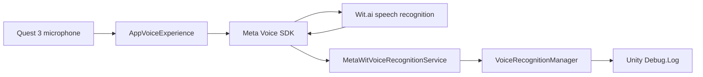

# Voice Recognition Setup

## A. Overview

This first slice captures audio through the Quest 3 microphone, sends it to Wit.ai through Meta Voice SDK, receives a full transcription, and writes it to the Unity console. It does not recognize intents or execute gameplay actions.

The source is split into:

- `VoiceRecognitionManager`: subscribes to the adapter and logs lifecycle, transcription, and error events.
- `IVoiceRecognitionService`: application-facing C# boundary for voice recognition.
- `MetaWitVoiceRecognitionService`: Meta Voice SDK adapter for `Oculus.Voice.AppVoiceExperience`.



### Speech recognition flow

1. `VoiceRecognitionManager.StartListening()` calls the configured service.
2. `MetaWitVoiceRecognitionService` calls `AppVoiceExperience.Activate()`.
3. Meta Voice SDK captures microphone audio and sends it to the configured Wit.ai app.
4. `AppVoiceExperience.VoiceEvents.OnFullTranscription` invokes the adapter.
5. The adapter forwards the text to the manager.
6. The manager prints `[Voice] Recognized speech: ...`.

The implementation does not wait for or create any gameplay action.

## B. Wit.ai configuration

1. Sign in at <https://wit.ai/>.
2. Create a Wit.ai application and choose a language that matches the training user.
3. Open the application's **Settings** page.
4. Enable the features needed for automatic speech recognition. For transcription-only MVP testing, intents and entities are not required.
5. Add a few representative **Utterances** if you plan to test intent recognition later. Do not train or rely on them for this MVP.
6. Copy the application **Server Access Token** from the Wit.ai app settings.
7. Never put the token in C#, the Unity scene, a prefab, or Git. Configure it in the Meta Wit configuration asset in the Unity Editor.

For this MVP, distinguish between:

- **Transcription**: the text of what the user said.
- **Intent recognition**: a semantic action such as “select the tool,” derived from configured intents and utterances.

The current code logs transcriptions only and does not interpret intents.

## C. Unity package installation

The project manifest already includes `com.meta.xr.sdk.all` 209.0.0. Its resolved lock file installs `com.meta.xr.sdk.voice` 85.0.1. Therefore the exact package API used by the source is available in principle; a Unity Editor still needs to refresh/import the package.

Meta lists Voice SDK v85 as soft-deprecated in All-in-One and recommends installing `com.meta.xr.sdk.voice` separately for future use. Do not change package versions until the Editor can verify compatibility.

To finish installation:

1. Open the project in Unity `6000.3.23f1`.
2. Open **Window > Package Manager**.
3. Verify **Meta XR Voice SDK** is shown and that its version is compatible with the existing All-in-One package.
4. If missing, use Package Manager's **Add package by name** with `com.meta.xr.sdk.voice` and version `85.0.1`.
5. Accept no unrelated package upgrades.
6. Let Unity recompile and check for namespace/import errors.

Create or select a Wit runtime configuration through the Voice SDK/Wit.ai Inspector tools. Assign it to the `AppVoiceExperience.Runtime Configuration` field. Paste the Server Access Token into the Wit configuration asset's secure editor field only. The SDK handles the network request; the source contains no credential.

Official documentation:

- Meta Voice SDK overview: <https://developers.meta.com/vr/documentation/unity/voice-sdk-overview/>
- Meta Voice SDK package: <https://developers.meta.com/downloads/package/meta-voice-sdk/>
- Wit.ai console: <https://wit.ai/>

## D. Scene setup

No scene, prefab, or asset must be generated until Unity Editor access is available. The later manual setup should use this hierarchy:

```text
SampleScene
└── VoiceRecognition
    ├── AppVoiceExperience
    └── VoiceRecognitionManager
```

Use the following setup:

1. In `Assets/Scenes/SampleScene.unity`, create an empty GameObject named `VoiceRecognition`.
2. Add `Oculus.Voice.AppVoiceExperience` to that GameObject.
3. Add `MetaWitVoiceRecognitionService` to the same GameObject.
4. In `MetaWitVoiceRecognitionService`, assign its **Voice Experience** field to the `AppVoiceExperience` component on the same GameObject.
5. Add `VoiceRecognitionManager` to the same GameObject.
6. In `VoiceRecognitionManager`, assign **Voice Service Behaviour** to `MetaWitVoiceRecognitionService`.
7. Leave **Start Listening On Enable** unchecked for the initial manual test unless the test is specifically intended to start automatically.
8. Assign the `AppVoiceExperience` Wit runtime configuration through its Inspector.
9. Do not assign unrelated scene objects. The implementation has no furniture or workstation references.

If Unity does not discover `AppVoiceExperience`, the Voice SDK package or generated assemblies are not installed or imported correctly. Stop and resolve compilation/package setup before scene setup.

## E. Microphone and Quest 3 configuration

The Android build must allow microphone access:

1. Open **Edit > Project Settings > Player > Android**.
2. Use **Other Settings > Package Name** and Android target settings appropriate for Meta Quest.
3. Confirm Android microphone permission is requested by the Voice SDK/build configuration.
4. If Android's permission dialog does not appear, inspect and add the `RECORD_AUDIO` permission using the Unity Android manifest or XR/Meta permission support available in the project.
5. Grant microphone permission on the Quest when prompted.
6. Test network connectivity: Wit.ai requires internet access for recognition.
7. Keep the headset away from external noise where possible.

The initial physical target is a 2 m × 1 m area. This voice test requires no movement; keep the headset user stationary and within reach of a safe testing position.

## F. Testing procedure

Environment: Unity Editor for wiring and compile checks; Meta Quest 3 for microphone and recognition validation.

1. Open `SampleScene`.
2. Complete the scene setup and Wit configuration.
3. Build and deploy to Quest 3.
4. Start the application and grant the microphone permission.
5. In an initial test, enable **Start Listening On Enable** and restart the scene. Alternatively, call `VoiceRecognitionManager.StartListening()` from a temporary test control.
6. Say a short test phrase, for example, "select the diagnostic tool".
7. Wait for listening to stop and for Wit.ai to return a full transcription.
8. View logs through Unity/ADB/Meta development tools.

Expected logs:

```text
[Voice] Listening started.
[Voice] Recognized speech: select the diagnostic tool
[Voice] Listening stopped.
```

Error example:

```text
[Voice] Recognition error: <error-code> - <error-message>
```

This MVP does not expect a separate no-speech event. The SDK's stopped event can occur for timeout or inactivity without a usable full transcription.

Pass condition: the intended phrase appears in the Unity log and no gameplay object changes.

## G. Troubleshooting

### Microphone permission denied

Check Android/Quest permission state, restart the app after changing permissions, and verify `RECORD_AUDIO` is present in the Android build.

### Wit.ai token invalid

Confirm the Server Access Token is copied from the correct app and that it is assigned to the Wit runtime configuration. Rotate the token and update the local asset if it has been exposed.

### No internet connection

Confirm the Quest can reach the Wit.ai service and verify the app has connectivity. Retry in a network with no captive portal.

### SDK package missing

Open Package Manager and verify `com.meta.xr.sdk.voice`. Reimport packages and rerun Unity compilation.

### SDK API or package incompatibility

The source was checked against package version `85.0.1`. If Unity reports missing types or methods, do not substitute speculative APIs. Record the installed package/version and update the adapter from the package's actual C# API.

### No transcription received

Confirm Wit runtime configuration, internet access, microphone permission, and that `OnFullTranscription` fires. Check for partial but no full transcription; waiting for silence or speaking a longer phrase may be necessary.

### Scene references missing

Assign `AppVoiceExperience` inside `MetaWitVoiceRecognitionService` and `MetaWitVoiceRecognitionService` inside `VoiceRecognitionManager`. The field names should match the serialized Inspector fields.

### Recognition works in Editor but not on Quest

Confirm Android permissions and build settings, test internet access on Quest, and verify Meta platform-specific SDK initialization. Editor success is not evidence of Quest runtime behavior.

## H. Future extensions

Keep future command parsing in a separate application class. Possible steps:

- Define a voice command enum.
- Add normalized command text parsing.
- Map parsed commands to existing application use cases.
- Add intent/entity handling through Wit.ai only after transcription logging is stable.
- Combine voice commands with controller and hand-tracking adapters.
- Add explicit cancellation and ambiguity feedback.

Do not implement these extensions in this MVP.
